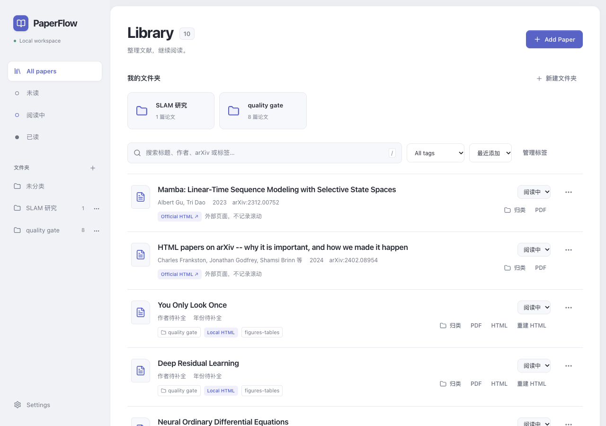

# PaperFlow

PaperFlow是一个本地论文管理与阅读工具，将 PDF 和 arXiv 链接放进同一个论文库，按自己的文件夹分类，在原始 PDF 和 HTML 之间切换，下一次打开时继续阅读。

应用在本机运行，通过浏览器访问。论文、分类和阅读进度保存在自己的电脑上，不需要账户或云数据库。主要面向 macOS Apple Silicon。

[快速开始](#快速开始) · [使用说明](#使用说明) · [配置 Marker](#配置-marker) · [备份与恢复](#备份与恢复) · [MIT License](LICENSE)



*论文库与文件夹分类。*

## 功能

- **PDF 与 arXiv 导入**：支持拖拽、文件选择、链接和 ID；重复 PDF 按内容去重，论文信息可手动编辑。
- **文件夹和标签**：自定义分类名称，一篇论文可以放入多个文件夹；分类对应 Finder 中的真实目录。
- **PDF 阅读**：保留原始排版，支持页码跳转、缩放、适配宽度和文本选择，自动保存阅读位置。
- **HTML 阅读**：优先提供可用的 arXiv 官方 HTML；本地 PDF 可以通过 Marker 转换，支持目录、公式、图片和表格。
- **搜索与阅读状态**：搜索标题、作者、arXiv ID 和标签，按时间、年份或标题排序，标记未读、阅读中和已读。
- **本地存储**：数据重启后保留，支持备份恢复；已有 PDF 和本地 HTML 可以离线阅读。


## 快速开始


### 环境要求

- Python **3.11 或更高版本**，推荐 3.12。
- Node.js **24 LTS**，包含 npm，用于安装和构建前端。
- Git、make，以及一个现代浏览器。

如果使用 conda，可以先准备 Python 环境：

```sh
conda create -n paperflow python=3.12 -y
conda activate paperflow
```

下面的 `python3` 应指向这个环境或其他已安装的 Python 3.11+，而不是 macOS 自带的旧版本。

### 安装并启动

```sh
git clone https://github.com/zhnnky329/PaperFlow.git
cd PaperFlow

make install PYTHON=python3
cp .env.example .env
make build
make serve
```

服务就绪后会自动打开默认浏览器，也可以访问 **[http://127.0.0.1:8000](http://127.0.0.1:8000)**。终端保持运行，按 `Ctrl-C` 停止服务。关闭浏览器标签页不会停止应用。

这一步不需要安装 Marker，可以先导入论文、建立分类和阅读 PDF。需要本地 HTML 时，再按下文配置转换器。

### 日常启动与更新

以后在项目目录运行：

```sh
make serve
```

构建完成后，日常运行不需要 Node.js，也不会在启动时加载模型。更新源码后，先停止服务、备份论文库，再重新安装依赖并构建；保留已有 `.env`：

```sh
make install PYTHON=python3
make build
make serve
```


## 使用说明


### 添加论文

点击右上角 **Add Paper**，选择导入方式：

- **PDF**：把文件拖入弹窗，或点击“选择 PDF 文件”。支持一次导入多篇，默认单文件上限为 100 MB。文件会复制到论文库，原文件不会被移动或修改。
- **arXiv**：粘贴论文链接或 ID，例如 `https://arxiv.org/abs/2107.06829`、`2107.06829` 或 `2107.06829v1`。应用会在后台获取标题、作者和摘要。

arXiv 导入默认只保存条目和链接。看到 **Remote only** 时，点击该论文的 **PDF**，再点击 **Download PDF**，下载后即可离线阅读。元信息获取失败不会丢失条目，可以点击“重试元信息”，也可以自行编辑。

### 按文件夹分类

点击侧栏“文件夹”旁的 **+**，创建自己的分类，例如“SLAM”“运动规划”或“准备精读”。

进入文件夹后点击 **Add Paper**，新论文默认存入当前分类。已有论文点击 **归类**，勾选一个或多个文件夹并保存；取消全部勾选后，论文会出现在“未分类”中。文件夹旁的 **…** 用于重命名和删除，删除分类会保留论文。

进入分类后，点击 **在 Finder 中打开**，可以看到对应的 PDF 目录：

```text
~/Library/Application Support/PaperFlow/folders/<文件夹名称>/
```

Finder 中保存的是独立副本，阅读器仍使用论文库中的原始 PDF。一篇论文放入多个分类会保存多份副本；远程条目下载 PDF 后才会生成副本。

分类在 PaperFlow 中管理，Finder 中新增、移动或改名的文件不会反向导入。修改过的副本和额外文件会保留；发生同步冲突时，按提示处理后点击“重试 Finder 同步”。

### 阅读论文


| 入口                    | 适合什么场景             | 阅读进度            |
| --------------------- | ------------------ | --------------- |
| **PDF**               | 查看原始排版，核对公式和图表     | 保存页码、缩放和滚动位置    |
| **Official HTML ↗**   | 阅读 arXiv 提供的官方网页版本 | 外部标签页打开，不记录滚动位置 |
| **HTML / Local HTML** | 连续阅读转换后的正文，调整字号和宽度 | 保存章节和滚动位置       |


官方 HTML 只有确认可访问后才会提供。没有本地 HTML 时，点击 **Convert**，完成后会出现 **HTML** 按钮。转换期间可以继续阅读 PDF；转换结果不理想时，也可以随时回到原文。

HTML 阅读页可以配合浏览器翻译插件使用。

### 管理论文库

论文行右侧可以修改阅读状态。点击 **…** 编辑标题、作者、年份、摘要、来源链接和标签，也可以删除论文。删除会再次确认，只清理该条目在 PaperFlow 数据目录内的资产，不会删除最初导入的原文件。

按 `/` 聚焦搜索，按 `Esc` 关闭弹窗。在 **Settings** 中可以调整浅色 / 深色主题、HTML 字号、正文宽度，以及转换模式和自动转换选项。

## 配置 Marker

PaperFlow 使用 [Marker](https://github.com/datalab-to/marker) 在本机将 PDF 转成 HTML。转换器安装在独立环境中，只有点击转换时才运行。

### 1. 安装转换器

在项目目录中，用前面准备好的 Python 执行：

```sh
python3 -m venv .marker-venv
.marker-venv/bin/python -m pip install -r backend/marker-requirements.lock
```

Apple Silicon 上还需要安装 llama.cpp 提供的 `llama-server`。如果使用 Homebrew：

```sh
brew install llama.cpp
command -v llama-server
```

也可以使用 [llama.cpp 官方二进制](https://github.com/ggml-org/llama.cpp/releases)，Apple Silicon 选择 arm64 版本。

### 2. 设置路径

编辑项目根目录的 `.env`，填写自己机器上的绝对路径，路径包含空格时保留引号：

```dotenv
PAPERFLOW_MARKER_EXECUTABLE="/absolute/path/PaperFlow/.marker-venv/bin/marker_single"
LLAMA_CPP_BINARY="/opt/homebrew/bin/llama-server"
```

`LLAMA_CPP_BINARY` 使用 `command -v llama-server` 返回的实际路径。如果希望指定模型缓存位置，还可以加入：

```dotenv
HF_HOME="/Users/you/Library/Caches/PaperFlow/models"
```

重启应用，在 **Settings → Conversion** 检查是否检测到 Marker。运行 `make doctor` 可以检查配置路径，不会加载模型。

### 3. 转换与重试

在论文行点击 **Convert**。任务在后台排队，一次转换一篇；运行中可以取消，失败可以重试。已有 HTML 可以点击“重建 HTML”，新结果成功前会保留旧版本。

默认使用 **Fast** 模式，导入后自动转换默认关闭。首次转换会联网下载模型，之后复用本地缓存。

## 数据与配置

默认数据目录为：

```text
~/Library/Application Support/PaperFlow/
```

数据库、PDF、生成的 HTML、图片和 Finder 分类目录都保存在这里。实际位置可以在 **Settings → Storage & recovery** 查看。

常用配置写在 `.env` 中，修改后重启生效：


| 配置                         | 默认值    | 用途                 |
| -------------------------- | ------ | ------------------ |
| `PAPERFLOW_DATA_DIR`       | 上述数据目录 | 自定义存储位置，使用绝对路径     |
| `PAPERFLOW_PORT`           | `8000` | 服务端口               |
| `PAPERFLOW_MARKER_TIMEOUT` | `1800` | 单次转换超时，单位为秒        |
| `PAPERFLOW_MAX_UPLOAD_MB`  | `100`  | 单个 PDF 上传上限，单位为 MB |


更换数据目录不会自动迁移已有论文库。需要搬迁时，先备份，再恢复到新目录。服务只监听 `127.0.0.1`，已缓存的论文可以离线阅读；arXiv 获取和首次模型下载需要网络。

## 备份与恢复

先停止应用，再运行：

```sh
make backup
```

归档默认放在数据目录的 `backups/` 下，命令会打印完整路径。备份包含数据库、论文资产和 Finder 分类目录，包括其中的额外文件；不包含 `.env`、Python 环境或模型缓存。建议把 ZIP 再复制到另一块磁盘。

需要指定备份位置时：

```sh
.venv/bin/python scripts/backup.py backup \
  --data-dir "/path/to/data" \
  --archive "/path/to/paperflow-backup.zip"
```

保持应用停止，将备份恢复到一个**尚不存在的新目录**：

```sh
.venv/bin/python scripts/backup.py restore \
  --archive "/path/to/paperflow-backup.zip" \
  --target "/path/to/restored-data"
```

然后把 `.env` 中的 `PAPERFLOW_DATA_DIR` 指向恢复目录，运行 `make serve`，检查论文、分类和阅读位置。恢复会校验文件和数据库；不要只复制 `paperflow.sqlite3` 来备份。

## 常见问题

**页面打不开，或提示端口被占用？** 检查终端里的服务是否仍在运行，先停止之前的实例。改过 `PAPERFLOW_PORT` 时，浏览器地址也要使用对应端口。

**首页只有 “PaperFlow API ready”？** 执行 `make build` 后刷新页面。

**Marker 没检测到，或转换失败？** 运行 `make doctor`，检查 `Configured Marker` 和 `Configured llama-server` 的路径，再核对网络、磁盘空间和可用内存。转换器在独立环境中，诊断里后端的 `marker-pdf: MISSING` 是正常的。中断任务在重启后可以重试，原始 PDF 保留。

## 反馈

欢迎通过 [Issues](https://github.com/zhnnky329/PaperFlow/issues) 反馈问题或提出建议。请附系统版本、复现步骤和错误提示；转换问题可补充公开论文链接。请勿上传私人论文、密钥或个人数据库。

## 许可证

PaperFlow 使用 [MIT License](LICENSE)。第三方依赖和模型权重遵循各自的许可证。

## 致谢

感谢 [Marker](https://github.com/datalab-to/marker) 的作者与贡献者。PaperFlow 的 PDF 转 HTML 功能基于 Marker，论文中的正文、公式、图片和表格由它提取，再交给本地阅读器展示。

也感谢 [PDF.js](https://github.com/mozilla/pdf.js) 和 [KaTeX](https://github.com/KaTeX/KaTeX)，分别提供 PDF 渲染和公式显示。
