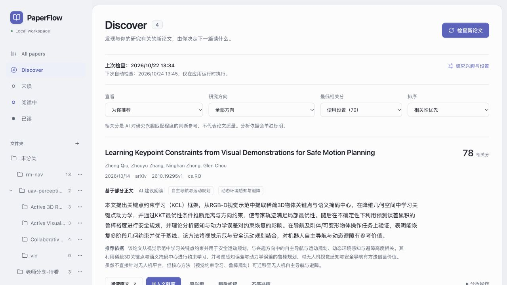
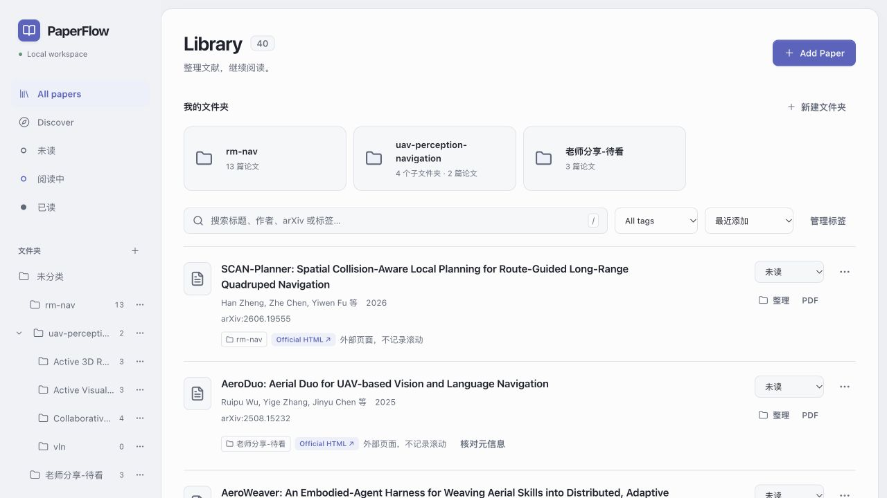

<p align="center">
  <picture>
    <source media="(prefers-color-scheme: dark)" srcset="docs/images/paperflow-logo-dark.png">
    
  </picture>
</p>
<p align="center"><strong>从发现到阅读，你的本地论文工作台</strong></p>
<p align="center">Ubuntu · AI 论文推荐 · 本地文献管理 · PDF / HTML 阅读</p>

<p align="center">
  <a href="LICENSE"></a>
  
  
</p>

PaperFlow 是一个通过本机浏览器使用的论文工作台。本分支面向 **Ubuntu 24.04 LTS x86_64**，论文库与阅读记录保存在本地，支持 NVIDIA GPU 加速 PDF 转换。

可选的 [Ubuntu / macOS 双机同步与远程转换](docs/PEER_SYNC.md)：两端各自保存论文库，Mac 运行 Discovery，可选择本机 Marker 或交给 Ubuntu CUDA 转换，并同步阅读进度与完整 HTML。默认关闭，保留现有本机入口。

## 主要功能

- **发现论文**：按研究方向从 arXiv 获取论文，使用 DeepSeek 生成中文总结与推荐理由。
- **管理文献**：导入 PDF 或 arXiv 链接，搜索、分类、标记阅读状态。
- **同步文件夹**：多层分类对应本地真实目录，支持文件管理器双向整理。
- **阅读与翻译**：阅读 PDF、arXiv 官方 HTML 或 Marker 转换的本地 HTML；PDF 和本地 HTML 支持保存阅读进度，可搭配 Read Frog 翻译。

## 界面预览

| Discover · 论文推荐 | Library · 文献管理 |
| --- | --- |
|  |  |

## 安装与启动

先安装 Miniconda 或其他 conda 发行版，再执行：

```sh
sudo apt update
sudo apt install git make xdg-utils

git clone --branch ubuntu https://github.com/zhnnky329/PaperFlow.git
cd PaperFlow
conda env create -f environment.yml
conda activate paperflow
make install
test -f .env || cp .env.example .env
make build
make serve
```

环境文件包含 **Python 3.12、Node.js 24 和 npm**。已有 `paperflow` 环境时，将创建环境的命令替换为 `conda env update -n paperflow -f environment.yml`。

启动后访问 **[http://127.0.0.1:8000](http://127.0.0.1:8000)**。以后在项目目录运行：

```sh
conda activate paperflow
make serve
```

保持终端开启，按 `Ctrl-C` 停止服务。无需自动打开浏览器时，使用 `python scripts/run.py serve --no-open`。

## 怎么使用

1. **导入论文**：点击 **Add Paper**，拖入 PDF 或粘贴 arXiv 链接 / ID。arXiv 论文可在阅读页点击 **Download PDF** 下载到本地。
2. **整理分类**：点击侧栏 **+** 创建文件夹，通过论文的 **整理** 按钮归类；支持打开本地文件夹或复制路径。
3. **开始阅读**：点击 **PDF** 阅读原文，或打开 **Official HTML**。安装 Marker 后，可点击 **Convert** 生成本地 HTML。
4. **开启推荐**：在 **Settings → Research Discovery** 填写研究方向、配置 DeepSeek API Key 并开启 AI 分析，然后进入 **Discover** 点击 **检查新论文**。

基础文献管理和 PDF 阅读可直接使用。AI 分析需联网并按 DeepSeek API 用量计费，详细配置见 [Research Discovery](docs/RESEARCH_DISCOVERY.md)。

## 可选：PDF 转 HTML

Marker 使用独立环境。在已激活的 `paperflow` 环境中，按设备选择一种安装方式。

### NVIDIA GPU

```sh
python -m venv .marker-venv
.marker-venv/bin/python -m pip install -r backend/marker-cuda-requirements.lock
```

此配置使用 CUDA 13.0 版 PyTorch，需要兼容的 NVIDIA 驱动。再从 [llama.cpp 官方发布](https://github.com/ggml-org/llama.cpp/releases/tag/b11836)下载 **Ubuntu x64 (CUDA 12)** 和 **CUDA 12.8 libraries**，解压后将运行库的 `.so*` 文件放到 `llama-server` 同一目录。

在 `.env` 中填写本机实际的绝对路径：

```dotenv
PAPERFLOW_MARKER_EXECUTABLE="/absolute/path/PaperFlow/.marker-venv/bin/marker_single"
LLAMA_CPP_BINARY="/absolute/path/to/llama-server"
PAPERFLOW_MARKER_DEVICE=cuda
```

### CPU

```sh
python -m venv .marker-venv
.marker-venv/bin/python -m pip install -r backend/marker-requirements.lock
```

安装 Ubuntu x64 CPU 版 `llama-server`，填写上面的两个路径，并将 `PAPERFLOW_MARKER_DEVICE` 设为 `cpu`。

配置后运行 `make doctor` 检查环境，再重启服务。在 **Settings → Conversion** 选择 Fast 或 Balanced 模式，通过论文的 **Convert** 按钮转换。首次使用会下载模型，之后复用本地缓存；本分支使用原生 llama.cpp，无需 Docker。

## 数据与备份

默认论文库位于 `~/.local/share/paperflow/`；设置了 `XDG_DATA_HOME` 时，使用其下的 `paperflow/`。可在 `.env` 中通过 `PAPERFLOW_DATA_DIR` 指定绝对路径，修改后重启生效。

先停止服务，再备份：

```sh
make backup
```

备份保存在数据目录的 `backups/` 下。恢复到一个尚不存在的新目录：

```sh
python scripts/backup.py restore \
  --archive "/path/to/paperflow-backup.zip" \
  --target "/path/to/restored-data"
```

将 `.env` 中的 `PAPERFLOW_DATA_DIR` 指向恢复目录后启动。由 macOS 迁移时，同样先在原机器生成备份，再复制到 Ubuntu 恢复，并重新配置 API Key 和 Marker。

## 许可

项目使用 [MIT License](LICENSE)。感谢 [Marker](https://github.com/datalab-to/marker)、[PDF.js](https://github.com/mozilla/pdf.js) 和 [KaTeX](https://github.com/KaTeX/KaTeX)。问题与建议可提交到 [Issues](https://github.com/zhnnky329/PaperFlow/issues)。
